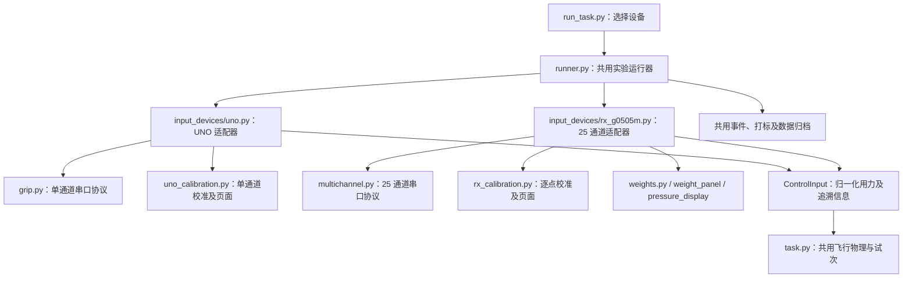

# 两款握力计的模块结构

更新日期：2026-10-15。原先暂缓的结构整理现已实现。两个入口使用同一运行器和游戏核心，通过设备适配器选择采集、校准、用力换算和专用界面。

## 使用方式

现有启动方式继续使用，项目可整体迁移：

```bash
# UNO 单通道
bash launch_hardware.command

# RX-G0505M 右手 25 通道
bash launch_multichannel.command

# 无硬件测试：任一启动命令后加 --simulate
bash launch_multichannel.command --simulate
```

统一 Python 入口也可以选设备：

```bash
python run_task.py --grip-device uno
python run_task.py --grip-device rx-g0505m
```

25 通道仍默认跳过零点和最大握力标定，打开游戏及实时权重面板；右侧仍显示右手 25 点压力，初始权重和升力参数保持原值。UNO 保留原来的校准流程。切换设备无需修改游戏规则。

## 文件职责



| 文件 | 职责 |
|---|---|
| `run_task.py` | 命令行参数、串口列表、启动统一运行器 |
| `gripflight/runner.py` | 会话生命周期、唯一游戏循环、显示刷新、翻帧事件、打标、记录和退出清理 |
| `gripflight/task.py` | 接收归一化用力，计算平滑和升力，运行飞行、碰撞和试次状态机；不读取串口、不解释传感器单位 |
| `gripflight/input_devices/base.py` | `ControlInput` 数据结构及 `InputDevice` 生命周期接口 |
| `gripflight/input_devices/__init__.py` | 根据设备名加载对应适配器 |
| `gripflight/input_devices/uno.py` | UNO 端口配置、采集管理、绝对值/零点/范围换算、按设备样本提供控制步 |
| `gripflight/input_devices/uno_calibration.py` | UNO 零点、三次握紧、单通道校准结果页面 |
| `gripflight/input_devices/rx_g0505m.py` | RX 设备协议手别筛选、加权映射、主机控制时钟、权重面板和五指图接入 |
| `gripflight/input_devices/rx_calibration.py` | 25 通道逐点零点、峰值参考及带五指图的校准页面；可按配置跳过 |
| `gripflight/calibration.py` | 共用校准设置校验及 `ExperimentSetup` 归档；保留旧 UNO 校准函数的转发入口 |
| `gripflight/weighted_task.py` | 旧调用的兼容入口，转发到统一运行器，不再维护另一份游戏循环 |

原有底层串口模块 `grip.py` / `multichannel.py`、数据存储 `recording.py` 和打标模块 `markers.py` 保持独立。校准页面由设备适配器选择：UNO 使用基础 `Display`，RX 使用带压力图的 `WeightedDisplay`。图形底层和游戏绘制继续复用。

## 统一输入约定

设备适配器把原始传感器读数转换为 `ControlInput`：

- `normalized`：0–1 用力指标；两种设备使用同一平滑和升力公式。
- `lift_gain`：当前升力系数。RX 面板实时修改后，w随相应参数版本进入游戏。
- `valid`：是否允许本控制步推进物理运动。
- `sample_id`、`received_at`、`device_sequence`、`acquisition_id`：追溯原始采集记录和时间。
- `reused`：是否重复使用上一次接收帧。
- `hand`、`weight_revision`、`metrics`：可选的设备协议手别、权重版本和设备计算信息；RX 的 metrics 另含 display_hand（测试显示手别）。
- `raw`：仅供原有任务日志追溯，游戏核心不再根据它计算归一化。

游戏核心的接口为 `Task.tick(normalized, valid=True, raw=None)`；旧的直接传电压方式需先调用 UNO 的 `normalize()`。原有启动脚本不受此接口调整影响。

UNO 的换算保持 `clip((abs(raw)-grip_min)/(grip_max-grip_min), 0, 1)`。RX 仍用各通道权重、零点和参考范围计算归一化用力，具体见 [右手加权调参与游戏](右手加权调参与游戏.md)。

## 采集与控制时序

统一接口不要求两款设备使用相同采样时钟：

- **UNO**：按设备样本顺序提供控制步，默认 256 Hz。短缺样保留无效时隙，推进试次时钟但不推进物理运动；序号、设备时间和原始数据关联继续保存。积压、断流和协议错误按原采集逻辑报错。
- **RX**：原始帧按真实到达时间保存，游戏按主机 60 Hz 控制。相邻控制步可使用同一接收帧，明确记录 `input_reused`。暂停时继续采集和显示压力。所选设备手别超时仍停止，另一协议手别不能替代它。当前设备输出 left 帧，界面为 right，两者独立配置。

帧率不作为设备采样率；RX 协议没有设备时间戳或序号，因此这两个信息仍不能由主机凭空补齐。

`task.csv` 保留原有字段，增加 `input_normalized`，明确记录每个控制步收到的用力（包括非飞行阶段）。`experiment_setup.json` 增加 `device_input` 接口与时钟说明；UNO 保存 `scalar_input` 换算范围，RX 继续保存 `weighted_input`。退出时先结束面板修改，再结束打标、采集和显示，最后保存参数及会话。

## 验证

自动回归覆盖：同一用力下两种设备得到相同飞行结果、UNO 原始换算及无效样本、按序采样与记录关联、设备手别与显示手别分离、重复帧、暂停与实时调权、两种校准算法、事件翻帧及异常退出清理。

此次结构整理后的两种设备均通过 PsychoPy Standalone 模拟窗口运行检查。真机交互已在重构前由用户确认；重构后仍需实际按压复核，模拟测试不等于真机验证。
