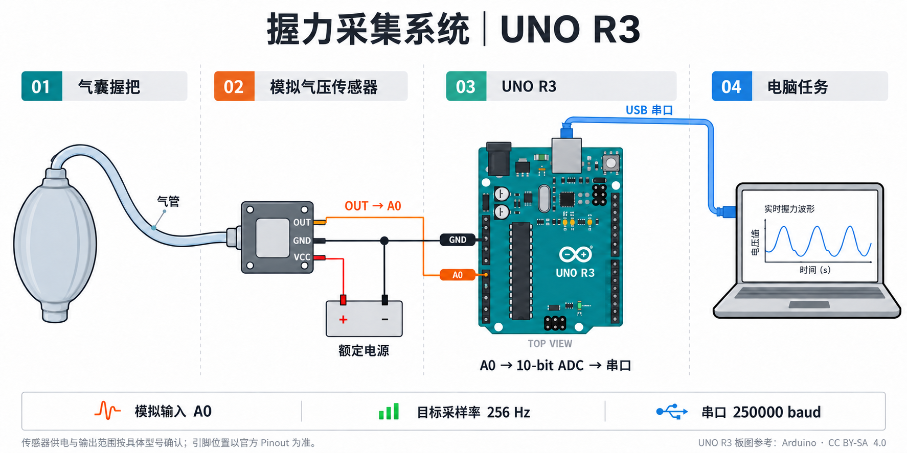
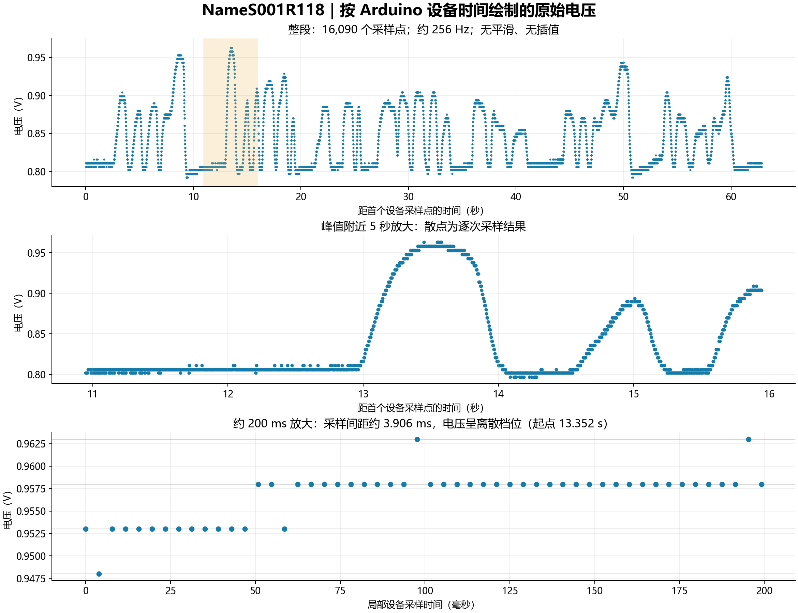

# 握力计使用说明：UNO R3 模拟量采集版

> 对应本仓库当前的 `sketch_common_analog.ino`。这里的“模拟量”是传感器输出的真实模拟电压；命令中的 `--simulate` 才是无硬件的软件模拟。



**数据路径：握紧气球 → 气压变化 → 传感器输出模拟电压 → UNO R3 的 A0 → 板载 ADC → USB 串口 → 电脑任务。**

示意图参考 [Arduino 官方 UNO R3 Pinout（第 1 页）](https://docs.arduino.cc/resources/pinouts/A000066-full-pinout.pdf)，采用简洁板图与分色接线：橙色为模拟信号，黑色为地线，红色为供电正端，蓝色为 USB。导线相交处只有带实心圆点才表示相连。

板图参考来源：Arduino，原图许可 [CC BY-SA 4.0](https://creativecommons.org/licenses/by-sa/4.0/)；本项目改绘示意图沿用该许可，并非 Arduino 官方接线图。图片由内置图像生成工具重绘，[生成提示词](images/grip_uno_overview_v2.prompt.txt)随图保存。转发本文时，请同时保留 `images` 文件夹。

图中引脚位置只是概念示意，实际接线认板上标注的 **A0、GND、5V**，不要照插图上的物理位置插线。电源的回路连接见下表。

## 1. 硬件与装配

### 材料

- Arduino **UNO R3** 一块，以及可传数据的 USB 线。
- 气球或可挤压气囊、匹配的气管及接头。
- 带**模拟电压输出**的气压传感器模块。
- 接线、固定传感器和气管的支架或外壳。

当前尚未确认气压传感器的具体型号。以下用 **OUT、VCC、GND** 表示功能名称；实际模块可能标成 **AO、VOUT、VS** 等，请按它的数据手册识别。裸传感器、数字输出模块不一定具有这三个接口。

### 接线表

断开供电后接线，先确认模块的额定供电和输出范围。

| 从哪里 | 接到哪里 | 说明 |
|---|---|---|
| 气球/气囊出口 | 气管 → 传感器测压口 | 固定接头，避免漏气和气管折弯；差压型号的参考口按数据手册处理 |
| 传感器模拟 OUT | UNO R3 **A0** | 本固件只读取 A0，不是 A3，也不是数字口 D3 |
| 传感器 GND | UNO R3 **GND** | 信号必须共地 |
| 传感器 VCC | 符合模块要求的电源正端 | **只有确认模块支持 5 V 且电流需求合适，才可接 UNO 的 5V 引脚**；不要将 VIN 当成 5V 输出 |
| 外接电源负端（如使用） | 传感器 GND 和 UNO GND | 形成共同参考；不要把外部电源正端随意并到 UNO 的 5V 上 |
| UNO USB 接口 | 电脑 USB | 电脑读取虚拟串口；USB 也为 UNO 供电 |

**A0 接收电压，不直接接气管或裸应变电桥。** 当前固件按默认约 5 V 参考电压换算，输入需保持在 GND～板上实际参考/供电电压范围内。若传感器输出为 0–10 V、4–20 mA 或微弱电桥信号，需要相应调理电路，不能原样接入本方案。

把传感器和 UNO 固定在不会被握持挤压的位置，并给气管、USB 线留出余量。气球只负责把握持动作转成气压变化，不是经过标定的标准测力把手。

### UNO 做了什么？

UNO R3 的 ADC 为 10 位，`analogRead(A0)` 得到 `0～1023`。当前固件用下面的公式把 ADC 计数换算成电压后发送：

```cpp
int raw = analogRead(A0);
float voltage = raw * (5.0f / 1023.0f);
```

其中 5.0 是固件采用的标称参考值。若需要准确的绝对电压，应核对实际参考电压；若需要 N 或 kgf，还需要对完整握把结构做力学标定。UNO R3 的 ADC 和引脚说明见 [Arduino 官方 analogRead 文档](https://github.com/arduino/reference-en/blob/master/Language/Functions/Analog%20IO/analogRead.adoc)。

## 2. 下位机：上传现有 INO

完整固件：[sketch_common_analog.ino](../arduino/sketch_common_analog/sketch_common_analog.ino)。本说明末尾也附有当前代码，便于一起阅读。

1. 用 Arduino IDE 打开上面的 INO，开发板选择 **Arduino Uno / UNO R3**。
2. 选择这块 UNO 对应的端口并上传。上传前关闭占用该串口的任务或串口监视器。
3. 如用串口监视器检查，将波特率设为 **250000**；运行电脑任务前关闭监视器。

| 参数 | 当前值 |
|---|---|
| 模拟输入 | A0 |
| 目标采样率 | 256 Hz，平均间隔 3906.25 μs |
| 串口 | 250000 baud，8 数据位、无校验、1 停止位 |
| 数据编码 | ASCII 文本，以换行结束 |
| 数据列 | 温度占位、电压、采样序号、设备采样时间 |

串口的一条数据示例（数值仅演示格式）：

```text
0.00,0.812,1234,4820312
```

| 字段 | 含义 |
|---|---|
| `0.00` | 兼容旧格式的占位字段；当前没有测量温度 |
| `0.812` | A0 的电压估计值，单位 V，打印三位小数 |
| `1234` | 32 位采样序号，用于识别缺样 |
| `4820312` | 设备 `micros()` 时间，单位 μs，在 `analogRead()` 前记录；不是电脑收到数据的时间 |

序号和设备时间都允许 32 位回绕。固件按预定时间采样；若错过时刻或发送缓冲不足，会留下序号缺口，不会用一串补采数据冒充等间隔测量。因此 **256 Hz 是目标速率，需要结合实际序号和时间检查采集质量**。

电脑端还可能发送 `Q,请求编号\n`，UNO 回复 `S,请求编号,接收时间us,发送时间us\n`。这是时钟对齐消息，不是握力样本。项目的读取器已经把它和采样数据分开处理。握力 USB 时间对齐本身不等于已与脑电时钟同步。

### 原始电压数据示例



**图：按 Arduino 设备时间绘制的原始电压。** 用户提供的 NameS001R118 记录图标注共 16,090 个采样点，约 256 Hz，无平滑、无插值。

| 图层 | 数据说明 |
|---|---|
| 上图：完整记录 | 横轴为距首个设备采样点的时间（秒），纵轴为电压（V）；阴影标出下图放大区间 |
| 中图：5 秒局部 | 每个散点代表一次采样，可观察电压上升、峰值及回落过程 |
| 下图：约 200 ms 局部 | 横轴为局部设备采样时间（毫秒），采样间隔约 3.906 ms；电压呈离散档位 |

按当前固件的换算公式，ADC 每档约为 `5 / 1023 ≈ 0.00489 V`，串口输出保留三位小数。局部重复值及阶梯状变化与这一量化特征一致，不表示每个采样点的电压都必须变化。图中数值为电压，未转换为力。

本图用于说明数据形态；采样完整性仍需结合原始记录中的序号和设备时间检查。转交文档时，请同时保留 `images` 文件夹。

## 3. 电脑端：读取与简单任务示范

示例文件：[examples/read_grip_demo.py](../examples/read_grip_demo.py)。它复用当前项目的读取器，需要和本仓库一起使用；不需要 PsychoPy 窗口，也不需要打标 Arduino。

示例任务持续 10 秒：读取每个样本，把电压映射到 0～1，在跨过 20% 阈值时写入本地事件，最后保存原始握力和任务记录。终端每秒更新约 5 次，后台目标采样率仍是 256 Hz。

### 先运行无硬件演示

在项目根目录运行。Mac 可使用现有启动包装器，避免直接调用 PsychoPy 内置 Python 时缺少库路径：

```bash
bash run_python.sh examples/read_grip_demo.py --simulate
```

Windows 在已配置的 Python 环境中：

```powershell
python examples/read_grip_demo.py --simulate
```

这会产生明确标记 `simulated=true` 的人工波形，不代表硬件测量。如果使用独立 Python 环境，真实串口读取还需要在同一环境安装 `pyserial`：`python -m pip install pyserial`。

### 连接 UNO，查看端口

Mac：

```bash
bash run_python.sh examples/read_grip_demo.py --list-ports
```

Windows：

```powershell
python examples/read_grip_demo.py --list-ports
```

输出会包含端口名、USB 序列号和设备描述。**下面命令中的端口名是占位示例，需替换成上一步实际列出的名称。**

Mac：

```bash
bash run_python.sh examples/read_grip_demo.py --port /dev/cu.usbmodemXXXX --seconds 10
```

Windows：

```powershell
python examples/read_grip_demo.py --port COM6 --seconds 10
```

省略 `--port` 时，示例遵循 `config.json` 中的 `serial_devices.grip` 绑定。也可加 `--serial-number 实际USB序列号`。换板后核对序列号；有些兼容板没有唯一序列号，这种情况使用实际端口名。显式 `--port` 优先于序列号绑定，示例不会改写配置文件。

### 任务怎样使用读数

以下为示例的关键片段，省略了参数解析与退出处理；完整可运行版本见示例文件：

```python
reader = GripReader(
    recorder, port=port, baud=250000, gain=1.0,
    require_timing=True, sample_rate=256, ordered=True,
).start()
reader.wait_ready(timeout=5)
reader.begin_task()

# 在任务循环中调用；读取线程在后台持续采集。
for sample in reader.take_samples():
    if not sample['valid']:
        continue                    # 缺样不能当成真实握力
    voltage = sample['voltage']
    relative = max(0.0, min(1.0,
        (voltage - zero_v) / (reference_v - zero_v)))
    above_threshold = relative >= 0.20
    # 用 relative 更新反馈；阈值状态变化时记录本地事件。
```

示例默认 `zero=0.81 V`、`reference=1.20 V`，只是演示范围，**没有在示例中自动测量最大握力**。实际使用应先校准，再传入测得的值，例如：

```bash
bash run_python.sh examples/read_grip_demo.py --port /dev/cu.usbmodemXXXX \
  --zero 0.81 --reference 1.20 --threshold 0.20 --seconds 30
```

此示例假定用力时电压升高；要求 `reference > zero`。该相对比例是零点到参考电压之间的位置，不能直接称为牛顿、公斤力或经验证的生理最大力百分比。

### 数据保存与退出

默认保存在项目内 `data/grip_demo/日期时间_随机编号/`，每次运行创建新目录。`Ctrl+C` 可以结束。

| 文件 | 内容 |
|---|---|
| `grip.csv` | 原始电压、序号、设备时间、主机接收时间和有效性标志 |
| `task.csv` | 每个被任务处理的样本及归一化结果；`payload_json` 还包含阈值状态 |
| `events.csv` | 开始、结束和阈值进入/离开事件，仅本地记录 |
| `grip_sync.csv` | 真机运行时的时钟往返消息记录；软件模拟时不产生真实同步数据 |
| `metadata.json` | 本次参数、模拟标志和结束状态 |
| `session.sqlite3` | 原始记录数据库 |

读取器检查数据格式、序号、设备间隔和任务积压。这个教学示例遇到采集异常会结束并记录错误，便于发现接线或固件问题；它没有套用正式任务的继续运行降级逻辑。

### 接入现有 PsychoPy 任务

正式读取实现是 [gripflight/grip.py](../gripflight/grip.py)，入口在 [run_task.py](../run_task.py)。当前配置须匹配本固件：

```json
"grip": {
  "port": "填写实际端口或使用serial_devices绑定",
  "baud": 250000,
  "require_timing": true,
  "sample_rate": 256,
  "max_missing": 10,
  "max_lag_s": 0.25,
  "gain": 1.0,
  "stale_timeout_s": 1.0
}
```

这是配置片段，请合并到现有 `config.json`，不要覆盖整个文件。任务还应保持 `task.sampling_rate=256`、`task.sample_block_size=1`。

只有握力板、没有打标板时：

```bash
# Mac，在项目根目录
bash launch_hardware.command --no-markers
```

```powershell
# Windows，在项目根目录
.\launch_hardware.bat --no-markers
```

正式任务保留原有零点和三次握紧校准、本地事件、参数及地图保存流程。无打标板时，不会向脑电设备发送硬件事件码。

## 4. 前面讨论过的备选传感器

本对话中有以下方案方向，但没有可据此确认的具体采购型号和参数表。因此保留方案比较，不把某个型号写成已经选定的硬件。

| 方向 | 机械形态 | 接入 UNO R3 的方式 | 与当前方案的关系 |
|---|---|---|---|
| 气压传感器 | 气球/气囊 + 气管 | 带合适模拟电压输出的模块 → A0 | 当前方案；需确认实际模块供电、量程和输出 |
| 自贴应变片 | 把应变片粘在自制弹性梁或把手上 | 组桥 + 激励/放大/滤波 → 合适电压 → A0；也可用专用 ADC | 电路和粘贴、温漂、受力结构都需要设计，不能把裸应变片直接替代三线模块 |
| 成品梁式测力传感器 | 两个把手把力传给已经贴好应变片的弹性梁 | 电桥输出 → 信号调理 → A0，或电桥 ADC → 数字接口 | 与自贴应变片属于同一测量原理，区别是弹性体和应变片已集成 |

这里“贴片”按前面对话理解为**应变片**，不是采集肌电的电极。BIOPAC 双横杆、Jamar 可调握距、Charder 弹簧把手是此前提到的外形参考；单凭品牌或外形不能判断内部传感器，也不能认为可直接接 A0。

若改成 **梁式电桥 + HX711**，HX711 已负责放大与模数转换，再以数字接口传给 UNO，需要改写下位机读取代码；不能直接沿用 `analogRead(A0)`。还需重新核对该模块的真实输出速率与项目 256 Hz 配置，不要用重复读数补成 256 Hz。电桥和 HX711 的连接原理可参考 [SparkFun 官方接线指南](https://learn.sparkfun.com/tutorials/load-cell-amplifier-hx711-breakout-hookup-guide/all?print=1)。

若希望尽量沿用现有 INO，应选择**已经调理成兼容模拟电压的传感器或变送模块**，再核对带宽、供电、量程和机械安装。

## 5. 简单排查

| 现象 | 先检查 |
|---|---|
| 找不到板子 | USB 线是否可传数据；重新列出端口与序列号 |
| 端口无法打开 | 关闭 Arduino 串口监视器和其他占用程序；确认当前端口名 |
| 格式或采样率错误 | 是否上传本说明的四列固件；两端是否都是 250000 baud、256 Hz |
| 电压几乎不变化 | OUT 是否接 A0、是否共地；气管是否漏气；模块是否有模拟输出 |
| 长期贴近 0 V 或满量程 | 核对供电、输出范围、接线和传感器量程，先排除饱和 |
| 数值抖动或漂移 | 固定气管和线路，排查接触不良；检查零点和温度影响 |

## 附录：当前下位机完整代码

以下为本说明生成时的固件快照，实际上传文件仍以仓库内 [INO](../arduino/sketch_common_analog/sketch_common_analog.ino) 为准。没有修改当前实验使用的固件。

```cpp
// Fixed-rate grip acquisition: 256 Hz, A0, classic 5 V / 10-bit Arduino ADC.
// CSV: temperature_placeholder,voltage,sequence,device_sample_time_us
// Timestamp is taken immediately BEFORE analogRead(), not at host reception.
// Both uint32 counters wrap naturally. The host checks sequence and timing.
// 1e6/256 = 3906.25 us. Carry the fraction instead of rounding the rate.
const uint32_t SAMPLE_RATE_HZ = 256;
const uint32_t SERIAL_BAUD = 250000;
uint16_t sampleFraction = 0;
uint32_t nextSampleUs = 0;
uint32_t sampleSequence = 0;

void AdvanceSampleDeadline()
{
  nextSampleUs += 1000000UL / SAMPLE_RATE_HZ;
  sampleFraction += 1000000UL % SAMPLE_RATE_HZ;
  if (sampleFraction >= SAMPLE_RATE_HZ) { ++nextSampleUs; sampleFraction -= SAMPLE_RATE_HZ; }
}

void setup()
{
  Serial.begin(SERIAL_BAUD);
  nextSampleUs = micros();
  AdvanceSampleDeadline();
}

void SampleGrip()
{
  uint32_t now = micros();
  if (int32_t(now - nextSampleUs) < 0)
    return;

  // Do not take bursts of catch-up samples and call them regularly spaced.
  // Missed deadlines or TX-buffer exhaustion produce a visible sequence gap.
  uint32_t sequence = sampleSequence++;
  AdvanceSampleDeadline();
  while (int32_t(now-nextSampleUs) >= 0) {
    sequence=sampleSequence++;
    AdvanceSampleDeadline();
  }
  // A complete line is <= 35 bytes for this ADC. Reserve extra room so
  // Serial.print cannot block the sampling loop on classic AVR HardwareSerial.
  if (Serial.availableForWrite() < 48)
    return;

  uint32_t sampledUs = micros();
  int raw = analogRead(A0);
  float voltage = raw * (5.0f / 1023.0f);
  Serial.print("0.00,");
  Serial.print(voltage, 3);
  Serial.print(',');
  Serial.print(sequence);
  Serial.print(',');
  Serial.println(sampledUs);
}

char syncRequest[16]; uint8_t syncLength=0; bool syncDropping=false, syncReady=false;
uint32_t syncToken=0, syncRx=0;
void ServiceSync()
{
  // Keep decimal sync formatting away from the next sampling deadline.
  if (int32_t(nextSampleUs-micros()) < 1500) return;
  // Bound command work; never wait for bytes or TX capacity.
  for (uint8_t n=0;n<16 && Serial.available();++n)
  {
    char c=static_cast<char>(Serial.read());
    if (c=='\n')
    {
      uint32_t received=micros();
      if (!syncDropping && syncLength>2 && syncRequest[0]=='Q' && syncRequest[1]==',')
      {
        uint32_t token=0; bool good=true;
        for (uint8_t i=2;i<syncLength;++i) {
          char d=syncRequest[i];
          if (d<'0' || d>'9' || token>(UINT32_MAX-uint32_t(d-'0'))/10) { good=false; break; }
          token=token*10+uint32_t(d-'0');
        }
        if (good && !syncReady) { syncToken=token;syncRx=received;syncReady=true; }
      }
      syncLength=0; syncDropping=false;
    }
    else if (!syncDropping) {
      if (syncLength<sizeof(syncRequest)) syncRequest[syncLength++]=c;
      else syncDropping=true;
    }
  }
  // Reply <=36 bytes. Leave sample priority to the next loop; no blocking writes.
  if (syncReady && Serial.availableForWrite()>=48) {
    uint32_t sent=micros();
    Serial.print("S,");Serial.print(syncToken);Serial.print(',');
    Serial.print(syncRx);Serial.print(',');Serial.println(sent);
    syncReady=false;
  }
}
void loop() { SampleGrip(); ServiceSync(); }
```
