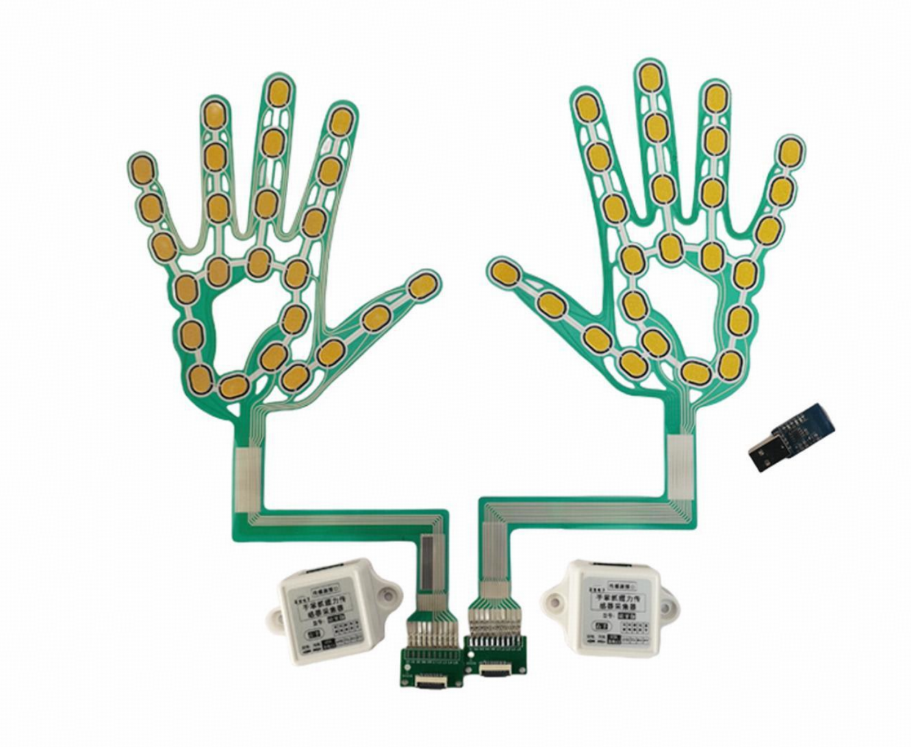
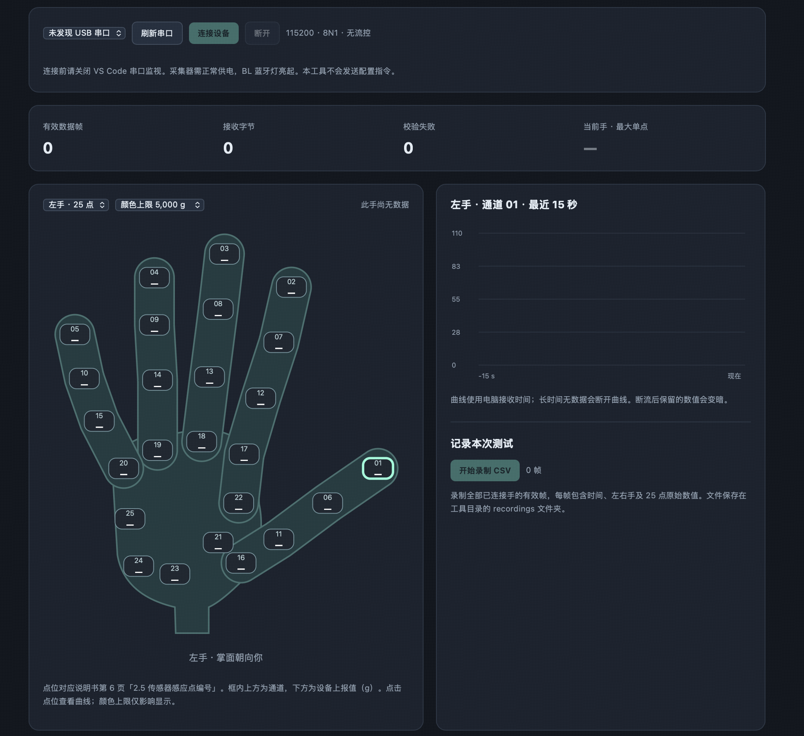

# 握力计使用说明：RX-G0505M 25 点传感器版

> 适用于 RX-G0505M 蓝牙采集器及配套 25 点柔性手掌传感器。文中的界面为临时开发预览，仅用于展示采集效果；串口解析方法可独立用于其他采集程序。



**图 1　RX-G0505M 设备组成。** 上方为左右手柔性传感器，黄色区域为感应点；下方为传感器转接板和两只白色采集器，右侧为 USB 蓝牙接收器。图片为部件展示，实际连接方式见下文。

图片由用户提供。转交本文时，请同时保留同目录下的 `images` 文件夹。

**数据路径：手掌施力 → 25 点柔性传感器 → 采集器 → 蓝牙 → 配套 USB 接收器 → 电脑串口 → 解析与记录。**

```text
手掌传感器 ── 转接板/FPC 排线 ── 采集器
                                  │ 内置电池供电
                                  │ 蓝牙
                                  ▼
电脑 USB / Hub ◀──────────── 配套 USB 蓝牙接收器
```

## 1. 硬件与装配

### 材料

- RX-G0505M 柔性手掌传感器及对应采集器。
- 配套转接板、FPC 排线、手套和固定绑带。
- 配套 USB 蓝牙接收器；电脑接口不匹配时使用 USB Hub。
- Micro USB 充电线。

### 连接表

| 从哪里 | 接到哪里 | 说明 |
|---|---|---|
| 传感器转接板 | FPC 排线 → 采集器 | 按手册确认方向和锁扣类型，插紧后锁定 |
| 采集器 | 配套接收器 | 蓝牙传输，出厂已完成配对 |
| 配套 USB 接收器 | 电脑 USB / Hub | 接收器使用 CH340，电脑通过其虚拟串口读取 |
| 采集器 Micro USB | USB 5 V 充电电源 | 默认仅充电，不传数据，不支持边充边工作 |

首次使用先充电；充电完成后拔掉充电线，将采集器拨到“放电”。上述供电方式适用于未改装的蓝牙版。

传感器应平整贴合手套或测试面，避免尖锐物直接按压。固定转接板和采集器，给排线保留活动余量。

### 状态指示

| 指示灯 | 含义 |
|---|---|
| PW | 电源状态 |
| BL | 蓝牙已连接时亮，断开时灭 |
| RX | 数据活动指示 |

电脑识别出串口，仅说明 USB 接收器已被识别；还需确认采集器的 BL 灯亮起。

## 2. 设备端：参数与数据输出

本方案使用厂家采集器，无需上传 UNO 固件，也无需额外单片机。连接后主动上报数据，不需要发送启动命令。

| 参数 | 值 |
|---|---|
| 每只手通道数 | 25 |
| 串口 | 115200 baud，8 数据位、无校验、1 停止位，无流控 |
| 数据编码 | 二进制，固定 53 字节/帧 |
| 单通道编码 | 无符号 16 位整数，高字节在前 |
| 解析输出单位 | g |
| 蓝牙单手最小采样间隔 | 20 ms，理论最高 50 帧/秒 |
| 蓝牙双手最小采样间隔 | 50 ms，理论每手最高 20 帧/秒 |

手册将以 ms 表示的设置称为“采集频率”，实际含义为采样间隔。当前工具不修改该参数，也不自动确认设备当前设置。

### 帧结构

下表偏移从 0 开始，通道从 1 开始。

| 偏移 | 长度（字节） | 内容 |
|---|---:|---|
| 0 | 1 | 帧头 `0x40` |
| 1 | 1 | `0x31` 左手，`0x32` 右手 |
| 2–51 | 50 | 通道 1–25，每通道 2 字节 |
| 52 | 1 | 前 52 字节之和的低 8 位 |

```text
40 31 HH LL HH LL ... HH LL CC
```

以上为十六进制表示。`HH LL` 表示一个通道的高、低字节，`CC` 为校验字节。

### 数值转换

```text
通道值（g）= 高字节 × 256 + 低字节
示例：02 AB → 2 × 256 + 171 = 683 g
```

电脑端按上述公式解析，不再进行电压换算或额外缩放。g 为手册规定的输出单位；当前工具未执行额外标定。

### 通道位置

25 点位置对应厂家手册第 6 页「2.5 传感器感应点编号」。通道 1–5 分别位于拇指、食指、中指、无名指、小指指尖。

工具按掌面朝向观察者显示手掌图，左右手镜像排列。镜像仅改变显示位置，不改变数据顺序：数组第 0 项始终对应通道 1，第 24 项对应通道 25。

## 3. 采集效果示例（开发预览）



**图 2　临时开发预览界面。** 上方为串口连接和接收统计，左侧为 25 点手掌受力图，右侧为所选通道曲线及 CSV 录制区。截图处于未连接设备状态，点位显示“—”，不代表测量值为零。

### 连接与测试

1. 确认采集器使用工作供电，BL 灯亮起。
2. 关闭 VS Code 串口监视、厂家软件或其他串口读取程序。
3. 在工具中选择实际 USB 串口，点击“连接设备”。本机曾使用 `/dev/cu.usbserial-130`，重新插拔后应重新确认。
4. 查看有效帧是否持续增长，选择对应左右手。
5. 逐点轻按，观察对应位置的数值与颜色变化；点击点位查看最近 15 秒曲线。

“颜色上限”仅调整显示比例，不修改设备量程或数据。超过 2 秒没有新帧时，保留读数变暗并显示数据年龄；该阈值为界面设置。

### 数据保存与退出

点击“开始录制 CSV”，再次点击结束录制。文件保存在 `handy/recordings/`，名称为 `rx-日期-时间-微秒.csv`。

| CSV 列 | 内容 |
|---|---|
| `timestamp` | 电脑接收时间，本地时间格式 |
| `hand_1_left_2_right` | `1` 左手，`2` 右手 |
| `point_01_g`–`point_25_g` | 通道 1–25 的设备上报值 |

每行一帧，共 27 列；双手数据可写入同一文件，以手标识区分。

录制由本地服务执行，关闭网页不会停止录制。点击“停止录制”或“断开”结束记录；终端按 Ctrl+C 停止服务并释放串口。

## 4. 接入其他采集程序或 PsychoPy 任务

### 接收流程

```text
打开串口 → 缓存字节 → 定位帧头和手标识 → 检查 53 字节完整帧
        → 校验 → 解析 25 通道 → 按左右手提交样本
```

- 一次读取可能包含半帧或多帧，必须保留跨次读取的缓冲区。
- 校验失败时仅丢弃首字节，重新寻找候选帧。
- 本协议不是文本行，不能沿用 UNO 的 CSV 分行解析，也不能进行 UTF-8 解码。
- 建议后台线程持续读取，通过队列向任务提交样本，避免窗口刷新阻塞采集。

推荐应用层样本结构：

```text
hand            "left" / "right"
values_g        25 个整数，按通道 1–25 排列
received_at     电脑接收时的 Unix 时间戳，单位秒
```

以上为建议接口，非设备帧内字段。现有 handy 服务内部使用 `hand="1"/"2"`、`values`、`time`，适配时进行命名转换即可。

### 与 UNO R3 版本的区别

| 项目 | UNO R3 模拟量版 | RX-G0505M 25 点版 |
|---|---|---|
| 波特率 | 250000 | 115200 |
| 数据格式 | ASCII CSV 行 | 53 字节二进制帧 |
| 测量数据 | 单通道电压 V | 每手 25 通道，按 g 输出 |
| 设备采样序号 | 有 | 本协议未提供 |
| 设备采样时间 | 有 | 本协议未提供 |
| `Q` / `S` 同步消息 | 固件支持 | 本协议未定义 |

不能仅修改 UNO 任务的串口名或波特率完成接入；需要替换读取与解析层，明确任务使用哪只手、哪个通道或何种组合指标，并适配相应采样节奏。现已提供本项目的 [25 通道独立采集模块](25通道采集模块.md)，支持后台读取与全部通道保存；现有飞行任务的游戏输入映射尚未修改。

设备帧没有采样序号和设备时间戳。电脑接收时间不能当作精确采样时间，校验失败计数也不能直接当作丢帧数。若任务需要与脑电对时，应单独设计并验证时间同步方案。

任务可以使用指定通道驱动反馈。若需要相对强度，可按 `(当前值 - 基线) / (参考值 - 基线)` 计算，并要求参考值大于基线；该处理属于任务层。25 点之和如被使用，应明确标为通道合计，不能未经验证直接解释为整体握力。

## 5. 简单排查

| 现象 | 检查项 |
|---|---|
| 找不到串口 | 配套 USB 接收器、Hub、CH340 识别；采集器充电口不是数据口 |
| 无法打开串口 | 是否被 VS Code、厂家软件或另一份工具占用 |
| 串口打开但无字节 | 供电状态、电量、BL 灯和蓝牙连接 |
| 有字节但无有效帧 | 115200 / 8N1、二进制读取、帧长和校验算法 |
| 有效帧增长但数值不变 | 传感器排线、左右手选择、实际按压位置 |
| 读数变暗 | 当前手超过提示阈值未收到新帧，显示的是历史值 |
| 读数偏差较大 | 实物量程与设备设置、贴合和受力方式；用已知载荷验证 |

## 附录：独立解析器

以下代码仅依赖 Python 3，可接收任意长度的字节块。每次 `feed()` 返回本次解析出的全部有效帧，剩余字节保留供下次处理。

```python
class RXParser:
    def __init__(self):
        self.buffer = bytearray()
        self.checksum_errors = 0

    def feed(self, chunk: bytes) -> list:
        self.buffer.extend(chunk)
        frames = []
        while len(self.buffer) >= 53:
            b = self.buffer
            if b[0] != 0x40 or b[1] not in (0x31, 0x32):
                del b[0]
                continue
            if (sum(b[:52]) & 0xFF) != b[52]:
                self.checksum_errors += 1
                del b[0]
                continue
            frames.append({
                "hand": "left" if b[1] == 0x31 else "right",
                "values_g": [
                    b[i] * 256 + b[i + 1]
                    for i in range(2, 52, 2)
                ],
            })
            del b[:53]
        return frames
```

将实际串口读取结果传入同一个解析器实例：

```python
parser = RXParser()  # 在接收循环外创建
# 每次读取后：
for sample in parser.feed(received_bytes):
    handle_sample(sample)
```

`received_bytes` 为串口返回的 bytes，`handle_sample` 为上层回调；该片段不负责打开串口。现有 macOS 串口打开、后台读取和资源释放实现位于 `handy/server.py`。

### 依据与验证范围

依据厂家《手掌抓握力传感器 RX-G0505M 蓝牙采集器用户手册》第 6–12、19–21、25–28 页及当前 handy 工具代码。

已在 Mac + 配套 USB 接收器上验证有效帧接收、随按压变化的通道值和 CSV 录制；解析测试覆盖分包、连续帧、校验失败重同步及大端解码。双手同时采集、其他操作系统和计量精度不在已完成验证范围内。
